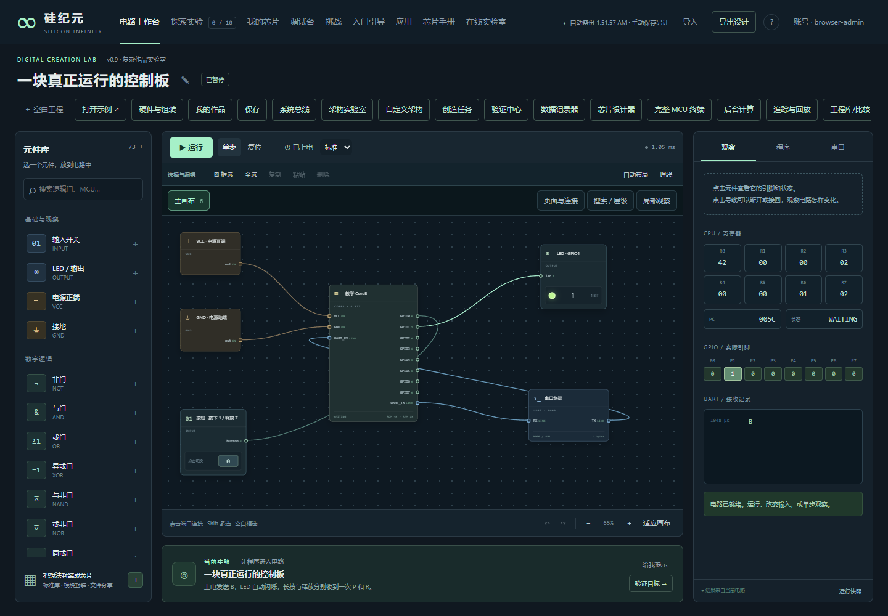

# Silicon Infinity · 芯片创造与协作实验室

在浏览器里从逻辑门搭起自己的芯片、电路和 MCU：设计、接线、写程序、上电观察，再逐步深入总线、存储器、中断、DMA 和完整系统。

本分支把 v0.9 游戏整理为可独立部署的网站。游戏引擎保持 **0.9.0**；部署包版本为 **0.9.0-selfhost.1**，属于自托管候选版。功能范围已经冻结到“可设计、可运行、可调试、可保存、可协作”的数字系统闭环；已在真实 fnOS 的 Linux amd64 容器中完成部署、持久化与备份恢复验收，并通过 42 项 Linux 自托管测试。项目仍需持续维护，详细范围见[验收记录](docs/SELFHOST-VALIDATION.md)。



## 可以做什么

- **设计自己的芯片**：逻辑门、总线、寄存器、存储器、参数化模块、分层封装和可修改的芯片库。
- **做完整 MCU**：可编程处理器、自定义 CPU、GPIO、定时器、中断、UART、SPI、I²C、DMA 和可运行系统实例。
- **看到运行结果**：LED、显示器、输入器件、协议设备、实验课程、挑战和复杂 MCU 示例。
- **定位复杂问题**：寄存器手册、单步调试、波形、跨模块追踪、条件暂停、记录回放、自动验证和多方案比较。
- **保存与共享**：浏览器工程修订库、文件导入导出；登录后使用本站共享芯片库和协作房间。

仿真面向数字逻辑与教学级系统设计。外设的部分协议采用功能模型；它不承诺晶体管、电气时序、模拟电路或真实硬件签核精度。本地电路和联机房间有明确资源边界，复杂度不会无限扩张。

## 最快启动

准备 Docker Engine 与 Docker Compose v2。在解压后的项目根目录运行：

```sh
cp .env.example .env
docker compose up -d --build
docker compose ps
```

本机打开 `http://localhost:8080/account` 初始化账号；游戏入口是 `http://localhost:8080/game/`。如果部署到 NAS，先把 `.env` 中的 `PUBLIC_ORIGIN` 改为实际访问地址，例如 `http://192.168.1.20:8080`。它必须与浏览器地址的协议、主机和端口一致。

首次启动会生成一次性初始化令牌；读取后在网页建立首个管理员：

```sh
docker compose exec app node selfhost/auth-cli.mjs setup-token
```

令牌是管理凭据，请勿贴到公开 Issue、截图或仓库。初始化完成后使用账号密码登录；其他成员通过管理员发放的邀请码注册。没有默认密码或开放注册。

镜像从本地源码构建，运行时不依赖外部托管平台、数据库服务或 npm 下载。默认数据保存在 Docker 命名卷，容器使用 UID/GID 1000，根文件系统只读。

- [本版验收记录与待验证事项](docs/SELFHOST-VALIDATION.md)
- [飞牛 fnOS 部署步骤](docs/DEPLOY-FNOS.md)
- [备份、恢复、升级与故障处理](docs/OPERATIONS.md)
- [自托管架构与资源边界](docs/SELFHOST-ARCHITECTURE.md)
- [芯片及 MCU 使用手册](docs/CHIP-USER-MANUAL.html)
- [复杂作品工具说明](docs/V0.9-COMPLEX-PROJECTS.md)
- [参与开发](CONTRIBUTING.md) · [安全策略](SECURITY.md) · [版本变化](CHANGELOG.md)

## 数据在哪里

| 内容 | 保存位置 | 备份方式 |
| --- | --- | --- |
| 账号、共享芯片、协作房间及服务端内容 | `/data/silicon.db` | 使用服务端备份命令 |
| 工程修订库、浏览器本地作品、偏好与未发布编辑 | 当前浏览器的 IndexedDB/localStorage | 在游戏中导出工程或作品文件 |
| 服务端备份文件 | `/data/backups/` | 定期复制到另一设备或备份介质 |

**备份 NAS 数据库不会自动备份每台电脑的本地工程。** 更换网址、端口、协议或浏览器，会进入不同的浏览器存储空间；迁移前先导出本地作品。

## 本地开发

安装 Node.js 24，复制 `.env.example` 供部署参考；直接运行 Node 时通过进程环境设置配置：

```sh
npm ci
npm test
npm run test:selfhost
npm start
```

默认监听 `0.0.0.0:8080`，数据目录为 `./data`。直接运行时建议明确设置 `PUBLIC_ORIGIN`；未设置时以 HTTP 请求的 Host 做同源检查。Compose 已明确提供默认值 `http://localhost:8080`。服务启动时自动执行有版本记录的数据库迁移，未知的较新数据库版本会拒绝启动。游戏前端没有构建步骤，直接维护 `game/` 中的 HTML、CSS 和 JavaScript。

```text
game/       电路引擎、编辑器、芯片库和运行工具
server/     共享库与协作房间的业务逻辑
selfhost/   HTTP 服务、账号、SQLite、迁移及运维工具
drizzle/    业务数据库迁移
tests/      引擎、兼容性、浏览器和自托管检查
docs/       使用、设计与部署文档
```

## 发布状态

CI 配置提供 Node.js 检查和 Docker 构建验证。容器发布工作流仅在推送与 `package.json` 版本一致的 `v…` 标签后执行，目标为当前仓库的 GHCR；配置覆盖 `linux/amd64` 与 `linux/arm64`。工作流配置不代表镜像已经发布，也不代表两种架构均已在真实 NAS 上验收。

本项目采用 [Apache License 2.0](LICENSE)，源码仓库为 [zjxlink/silicon-infinity](https://github.com/zjxlink/silicon-infinity)。当前为自托管候选版；自动检查结果见 [GitHub Actions](https://github.com/zjxlink/silicon-infinity/actions)。发布新版本前请完成[发布清单](docs/OPERATIONS.md#发布前检查)。容器镜像仅在版本标签触发的验证与发布流程成功后提供；工作流配置本身不代表镜像已经发布。
