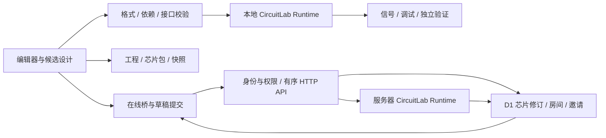

# v0.4 架构与数据边界

版本 0.4.0，2026-10-10。本文描述当前实现；本轮扩展位于末节，完整证据见 `ACCEPTANCE-V0.4.md`。发布结果见交付包 `qa/v0.4/deployment.json`。

## 运行结构

同一套功能级数字仿真内核运行于浏览器单机工作台和在线房间服务器。单机由本地 Runtime 执行；房间由服务器还原权威快照、执行有序操作，再保存新的共同状态。前端呈现收到的状态，不接受某一参与者自报的执行结果作为共同结果。

### 源码职责

| 位置 | 责任 |
|---|---|
| `game/circuit.js` | canonical 数据、四态信号、定义锁、导入与编译、层级展开、供电、全局调度、连接开关、快照、封装及协议路由 |
| `game/core8.js` / `core8plus.js` | 独立 Core8/1 与 Core8/2 CPU、汇编、内存映射及外设状态；旧 CPU 语义不因新版本暗改 |
| `game/hardware-v3.js` | 24 个固定签名的硬件行为模型、参数校验、组合计算与同步采样 |
| `game/builder-mcu.js` | Build8 汇编与 13 元件真实接线工程、观察和独立验证 |
| `game/app.js` / `style.css` / `index.html` | 编辑器、候选与已应用工程、选择与历史、文件保存、观察和扩展桥 |
| `game/hardware-ui-v3.js` | 参数、ROM 与 Build8 程序编辑、硬件实验入口 |
| `game/debugger-v3.js` / `challenges-v3.js` | 探针、断点、事务观察、挑战生成和行为验证、进度 |
| `game/lessons.js` / `chip-library.js` / `v2-examples.js` | 原实验、结构芯片与应用示例 |
| `game/online-v3.js` | 云库界面、指定修订导入、房间草稿和跟随、控制请求与轮询 |
| `server/cloud.mjs` | 身份与权限、持久化、发布校验、合并、顺序和幂等、服务器共同仿真 |
| `app/api/[...path]/route.ts` | Sites/Vinext 路由，把真实 DB binding 传给云服务 |
| `app/page.tsx` | 网站入口重定向到游戏页 |
| `tests/` / `tests/browser/` | 内核、数据、服务端与真实浏览器回归；不是游戏运行依赖 |

浏览器按 Core8/Core8Plus → HardwareV3 → CircuitLab → Build8/内容库 → app → 硬件界面 → 调试 → 挑战 → 在线的顺序加载。核心模块支持浏览器全局与 CommonJS，服务端复用内核；导入工程不会执行上传的 JavaScript。

## 模型与教学层次

当前注册 40 个模型：原 16 个基础/MCU/协议模型，加 24 个 v0.3 硬件模型。18 枚结构芯片使用实际内部电路，是另一类内容，不能重复算入基础模型数。

Core8/1 保留原指令、4 KiB ROM、1 KiB RAM、GPIO 与 UART 合同。Core8/2 显式增加定时器、PWM、IRQ、SPI 和 I²C，使用目标模型匹配的固件。UART 为 9600、8N1 的字节事务，每字节 1042 μs；SPI 每字节 8 μs，I²C 每寄存器事务 100 μs。实际连接、端点资格和连接版本决定是否送达。

Build8 由 PC、程序 ROM、指令寄存器、组合译码器、两拍控制器、累加器、零比较、ALU、RAM、总线选择器、输出寄存器、显示器与常量组成。每条指令取指、执行各一拍，16 位指令字、8 位累加器、256 字 ROM、256 字节 RAM。译码器只产生控制线，没有内部 CPU 执行器。Build8 当前为并行字节 I/O，不自动带有 Core8/2 外设。

## 数字信号与时间

数字向量宽度为 1—32，每一位明确表示 0、1、X、Z。信号值、已知与驱动掩码参与序列化；不能用有符号 32 位隐式转换丢失 bit31。浮空网络保留 Z，接收逻辑把没有有效默认值的未驱动输入当作未知；GPIO 读取未知位会故障并定位引脚。

数字端口、布尔供电端口和协议事务端口分开校验。固定输出不能错误互连；inout 输入模式驱动 Z。多个有效强驱动即使同值也产生冲突，弱下拉只有在没有强驱动时提供默认值。纯组合环、递归模块依赖、位宽或协议不符在编译阶段拒绝。

时间是精确非负整数微秒，内核以 BigInt 运算，保存为十进制字符串。同一时刻按以下次序处理：

1. 外部供电、复位、输入、连接开关等事件，按序号排列。
2. 到期通信与外设事件，先验证未取消且端点、连接版本仍有效。
3. 组合稳定；所有 CPU 与同步元件从共同快照采样。
4. 统一提交寄存器、存储及总线副作用，再预约后续事件。
5. 再次稳定，生成可观察状态。

暂停冻结全局时间。指令单步也推进其他元件和外设的共同时间。冷启动恢复初值；暖复位遵循对应模型的保留规则，例如 Core8 RAM 保留、外设复位、未完成通信取消。同步 RAM 的 RESET 引脚与全局暖复位不是同一操作。

已有导线可通过运行开关断开、接回；每次实际切换递增连接版本，并写入快照。在途事务不能因接回而恢复旧资格。新增、删除、改接导线或改固件属于候选设计，应用成功后原子冷启动。

## 定义、封装与格式

| 数据 | 格式 | 用途 |
|---|---|---|
| 工程 | `chip-game.project/0.1.0` | 定义、锁、实例、接线、固件、初值、电源域；兼容旧工程 |
| 编辑工作台 | `silicon-lab.workspace/1` | 工程加视图、源码、实验标记 |
| 完整模块包 | `chip-game.module-package/0.2.0` | 不可变复合定义、实际依赖、固件、电源域和源码映射 |
| 芯片分享文件 | `silicon-lab.chip/2` | 可放置芯片及可编辑原工程，导入时检查二者一致 |
| Runtime 快照 | `chip-game.snapshot/0.1.0` | 工程哈希、锁、精确时间、状态、事件、连接版本和历史 |
| 工作台快照外壳 | `silicon-lab.snapshot/1` | 将工作台与兼容运行快照一起保存 |

定义身份由 stableId、revision、contentHash 组成，内容以 canonical JSON 计算 SHA-256。同一身份不能暗改内容。新版本另存，并经显式升级进入工程；旧工程的锁保持原样。

层级展开以完整实例路径区分状态。放置模块时重映射私有电源域、固件及内部绑定；两份相同定义不共享 RAM、队列、运行阶段或可编辑源码草稿。封装保存实际依赖闭包，导入验证 hash、锁、引用、参数和资源预算。快照先完整校验再还原，不能在失败时部分写入旧 Runtime。

工程打开按初值重新开始；快照恢复则继续精确状态。新内核可读取符合兼容条件的旧快照，不表示旧内核认识新模型。Runtime 版本为 0.3.0。

## 编辑器、调试与验证

编辑器区分 project（候选）、applied（运行设计）和 rt（状态）。结构编辑进入候选；移动、布局与理线只修改 view。60 条撤销记录标明类型，视图撤销不替换运行状态。

复制以封装/放置能力复用实际依赖重映射，保留选中元件间的内部连线、参数、固件、电源域和源码。外部未选中的连线不复制，运行状态也不进入剪贴板。粘贴先验证独立候选，成功后整体提交。剪贴板只在当前页面有效。

插件通过 window.LabAPI 获取当前 Runtime、工作台、弹窗、渲染和操作，不缓存已经被替换的 Runtime。lab:workspace、lab:render、lab:tick 提供更新通知。统一模拟 driver 覆盖运行、按时间推进、逐拍和指令单步，保证断点能在副作用前停止。

调试最多 16 个数字探针，每探针 2048 次变化，事务最多 2048 条；显示实际保留区间和丢弃计数。记录在整数微秒稳定后采集，不声称观察组合求值过程内的瞬时波动。有捕获或断点时，每次调用推进最多 1000 μs；界面显示实际推进量。

实验和挑战在独立 Runtime 中验证候选，检查真实输入输出、时序和通信结果。验证不推进当前工作台。挑战进度保存工程哈希与挑战版本，历史通过不意味着后来修改仍正确。

## 云端持久化与授权

线上使用真实 Cloudflare D1 binding 保存作品、修订、邀请授权和房间状态。请求身份来自 Sites 可信代理提供的 `oai-authenticated-user-id`，缺少身份即拒绝；客户端不能通过工作台字段指定自己的用户身份。部署必须保留这一可信入口，不能把允许任意伪造该头的服务当作安全的公开部署。

网站访问权限与作品/房间权限是两层检查。当前网站仍为所有者访问；邀请对象还需在网站分享设置获得网站访问权。站内可见作品只对有网站访问权的登录用户可见，不是互联网匿名公开。私有作品的授权与房间 viewer/editor 授权由服务器逐次校验。

发布检查源码、视图、依赖、模块及可编辑工程一致性。修订正文不可变；请求 ID 与内容 hash 防止重试重复发布，更新携带预期上一修订以检测冲突。下载可以明确指定修订。邀请令牌只在创建时给出原文，数据库存 hash，期限 7 天；撤销同时取消由该邀请产生的授权。撤销不回收已下载的离线文件。

## 多人共同仿真

实现采用有序 HTTP 操作与轮询，**没有 WebSocket 或 Durable Objects**。运行中约 250 ms、暂停时约 900 ms 发起下一轮同步；网络请求耗时与调度会使实际间隔更长，不承诺实时帧率。

服务器保存工作台、权威快照、修订、epoch、控制者租约和每客户端序列号。每次运行操作从已保存快照恢复 Runtime，执行后以修订比较更新写回 D1。旧序列号重试不会再执行；内容不同的同序列操作、过期 epoch 和并发修订冲突被拒绝。

同一房间只有一个控制者。租约为 5 秒；权限撤销或失联后，在后续请求处理时释放控制并暂停。当前控制者的浏览器周期性请求推进最多 5000 μs；这是服务器执行的虚拟时间，不是后台常驻循环或墙钟实时仿真。

编辑者在本地草稿修改，通过实体级 before/after 操作提交。服务器合并未重叠修改，对同一对象已改变的提交返回冲突。源码按整个字段比较，不提供逐字 CRDT；既有不可变定义只能新增修订。成功的设计修改重新验证并冷启动共同电路，增加 epoch。房间 UI 的「复位」是冷启动；不能把本地暖复位操作描述为同一个按钮。

跟随模式呈现权威快照；进入本地编辑后才允许修改草稿。查看者的写入既由界面限制，也由服务器拒绝。客户端只读限制不是权限边界。

### 当前预算

| 范围 | 上限或行为 |
|---|---|
| 本地工程 | 1000 展开节点、4000 连线、128 定义、16 层；同时保留 authored 规模检查 |
| RAM/ROM/FIFO 新硬件 | 每个存储最多 256 项；FIFO 容量 1—256 |
| 云端 JSON 请求/发布 | 1 MiB，按实际 UTF-8 字节计数，读取流时限制 |
| 房间初始工作台 | 512 KiB，按 UTF-8 字节计数 |
| 房间展开 | 200 节点、800 连线、400 容器；在深入编译前预检 |
| 房间成员 | 最多 8 人，包含所有者 |
| 房间运行 | 快照最多 1 MiB、完整持久化状态最多 1.5 MiB、待处理事件最多 256 |
| 房间时间/计数 profile | 十进制数字字符串最多 32 位；超限拒绝，不近似转换 |
| 单次共享推进 | 1—5000 μs；整房间同一权威时钟 |

云端限制比本地更严格。预算是防止耗尽单次服务资源的发布 profile，不表示可以任意接近所有上限而仍保证交互帧率。后端配置通过 33 项业务测试和 6 项实际本地 Worker/D1 联调，生产发布凭证单独记录。

## 构建与离线交付

game 是源码，生产部署通过 Vinext/Workers 构建生成 dist/server 和 dist/client。Node 22.13.0+ 与依赖用于开发、构建、服务端和完整测试，不是离线游玩的前提。

离线交付应在独立暂存目录把 game 复制成 dist，附 game 源码、文档、示例和测试；绝不在源目录里用这一步覆盖在线构建结果。完整服务器源码和构建配置另附，不能把凭据、真实数据库、运行缓存或 node_modules 打包进去。离线入口不依赖登录和 CDN；云端入口仍需连接已部署服务。

具体目录和打包后检查见 [离线交付设计](V0.3-SIX-PARTS.md#离线交付设计)。本文没有执行打包、部署或改变网站访问权限。

## 保留的边界

功能级数字信号不模拟模拟电气、布线寄生、制造工艺、SPI 逐边沿、I²C 开漏多主仲裁。Build8 指令不兼容 Core8、ARM 或 RISC-V；本版不提供 RV32I、音视频协作或跨站匿名房间。自动理线也不是 PCB 布线器。Build8/2 在 v0.4 加入独立外设与中断，见下节。

[旧多人设计规格](SHARING-AND-MULTIPLAYER-SPEC.md) 保留为历史方案，其中未落地的传输架构不能作为本版能力声明。当前事实以本文、实际代码和 [v0.4 验收记录](ACCEPTANCE-V0.4.md) 为准。

## v0.4 扩展与兼容

运行时版本为 0.4.0，工程格式保持 `chip-game.project/0.1.0`；兼容旧版本快照，但仍检查完整工程和依赖指纹。`McuV4` 向统一调度器提供 12 个独立硬件模型，不改变已有 HardwareV3 定义的签名。新板的行为来自数据路径、MMIO 和请求线，不隐藏另一颗 CPU。详细事件顺序和协议取消规则见 [MCU-V4.md](MCU-V4.md)。

`silicon-lab.session/1` 分开保存候选工作台、已应用工作台和匹配后者的运行快照。作品管理先完整验证候选会话，再替换当前状态；存储用单键整体提交，配额失败不删除旧记录。完整模块的放置来源保存在 `view.moduleOrigins`，由原定义身份和当前放置定义 hash 共同确认，仅用于发现升级，不赋予执行权限。

浏览器协作客户端持久化尚未确认的请求，以服务器每客户端回执核对执行结果。恢复请求保留原序号、代次与内容；代次变化不重放旧操作。服务器仍通过 D1 修订条件更新、角色校验与指纹校验决定是否接受。会话退出后迟到回复不能重进房间，加入前未应用草稿和运行现场分别保留。

教学和系统应用复用真实工程、汇编器与 Runtime，在独立副本做验证。课程进度包含版本与设计指纹；本地学习和作品替换入口遵守共享房间保护。自动运行和重电路长推进在界面层分批，内核的整数时间、事件顺序和快照一致性不作近似。

