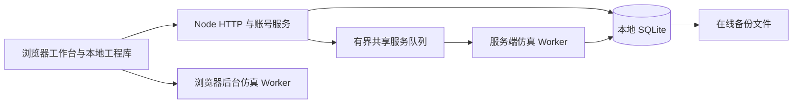

# 自托管架构与边界

部署包 `0.9.0-selfhost.1` 复用 v0.9 数字电路引擎，增加独立账号、HTTP 服务和 SQLite。它面向家庭 NAS、小型学习小组和单站点实验室；当前不提供多实例高可用、跨站点账号或公共 SaaS 容量保证。

## 运行结构

浏览器仿真和服务端协作仿真使用同一电路实现。浏览器里的普通运行、后台计算和本地工程库不会自动变成服务端存档。共享芯片及房间状态才由服务器保存。

网站直接提供 `game/` 静态文件，不需要前端构建或运行时下载依赖。Node.js 24 提供 HTTP、加密、Worker 和 SQLite 能力；运行镜像只包含应用所需源码、迁移、手册和许可证，不包含开发依赖或真实数据。

## 单实例与持久化

每个部署使用一个本地数据目录，包含 `silicon.db`、其 WAL/SHM 辅助文件、初始化令牌、`server-lock.sqlite` 互斥锁数据库及 `backups/`。Compose 默认采用 Docker 命名卷，也支持预先配置权限的 NAS 本地目录。

服务启动时持有互斥数据库上的独占锁；离线恢复、账号维护和第二个服务实例竞争同一把锁。进程崩溃或被强制终止后，操作系统释放文件锁，重启无需删除锁文件。禁止在任何相关程序运行时删除或替换互斥锁数据库。SQLite 数据目录必须位于本机文件系统；不支持把正在运行的数据库置于 SMB/NFS 或同步盘。

主库通过事务和版本化迁移管理。迁移文本哈希会记录并复核，换行符按 LF 规范化，避免 Windows 与 Linux 的普通换行差异误判；其他已发布迁移变更会被拒绝。备份使用 SQLite 在线备份接口，恢复要求停服并验证完整性，自动保留恢复前备份。

当前锁与数据库模型不允许通过增加容器副本来横向扩容。NAS RAID、容器自动重启和同盘备份各自解决不同问题，不能替代异地备份或真正的高可用设计。

## 身份与权限

- 首次管理员必须提交数据目录中的随机初始化令牌；网页不会返回该令牌。
- 后续账号通过管理员签发的一次性邀请码注册，独立于 NAS 和外部平台账号。
- 密码使用带随机盐的 scrypt 派生值保存；会话使用随机令牌，数据库保存其摘要。Cookie 为 HttpOnly、SameSite=Lax，配置 HTTPS 地址时附加 Secure。
- 修改密码或停用成员会撤销其会话。服务器从 Cookie 验证账号后，才把内部用户 ID 交给共享服务。
- 外部请求提供的身份、认证和代理头不能直接指定用户。共享服务内部保留的兼容身份字段只是进程间协议，不是面向公网的信任入口。
- 管理员账户管理、作品拥有权、共享作品邀请和房间角色分别校验。账号邀请码不会自动授权某个私有芯片或房间。

写入 API 要求 JSON 和与 `PUBLIC_ORIGIN` 一致的 Origin。正式部署应明确配置源地址，HTTPS 由反向代理终止；程序不凭任意转发头推断安全 Cookie 或访问身份。

## 仿真隔离和负载边界

HTTP/账号事件循环与服务端仿真 Worker 分离。共享服务一次执行一个请求；包括当前请求在内最多保留 32 个请求，队列满时返回 429。当前执行超时为 30 秒，Worker 启动限时 15 秒；执行失败会取消待处理队列并返回 503，随后尝试重建 Worker。Worker 的 V8 老生代上限为 256 MiB，这不等于整个进程或容器的内存峰值。

客户端收到恢复提示时应重新读取结果，再利用既有请求标识进行幂等重试，不能假定断线前的写入一定没发生。健康接口在共享服务尚未就绪时返回失败，不把恢复期间误报成全部可用。

| 项目 | 当前边界 |
| --- | --- |
| HTTP 同时连接 | 最多 128 |
| 请求头 | 16 KiB |
| 账号请求体 | 16 KiB |
| 共享服务请求体 / 芯片包 | 1 MiB |
| 房间工作区 | 512 KiB |
| 房间完整保存状态 | 1.5 MiB |
| 房间展开电路 | 200 节点、800 导线、400 容器 |
| 房间待处理仿真事件 | 256 |
| 房间单次推进 | 5000 µs 仿真时间 |

这些是拒绝超额输入的边界，不是 NAS 吞吐量承诺。具体可用房间数量取决于电路、使用方式和硬件。单个重任务与服务端资源约束应通过实际负载测量评估。

## 检查与未验证部分

`npm test` 运行原游戏核心与兼容性检查，`npm run test:selfhost` 验证账号、HTTP 与真实 SQLite，`npm run test:browser` 验证浏览器流程。

`npm run test:container` 构建并启动一个随机命名的独立 Compose 项目，分配回环端口及专用临时卷，验证真实账号、私有芯片、SPI MCU 房间在正常重启、SIGKILL 和备份恢复后的状态；最终只清理该测试项目。它不会连接现有生产部署。CI 中复用已构建镜像运行相同检查，并保存脱敏结果。

编写检查不等于已执行检查。当前交付环境若无法运行 Docker，相关报告必须标为未执行；真实 fnOS、反向代理和目标 CPU 架构仍需在部署设备验收。GitHub 工作流仅在维护者上传仓库并触发后运行。具体状态以本次自托管验收记录为准，历史托管平台的验收不替代这里的部署检查。
